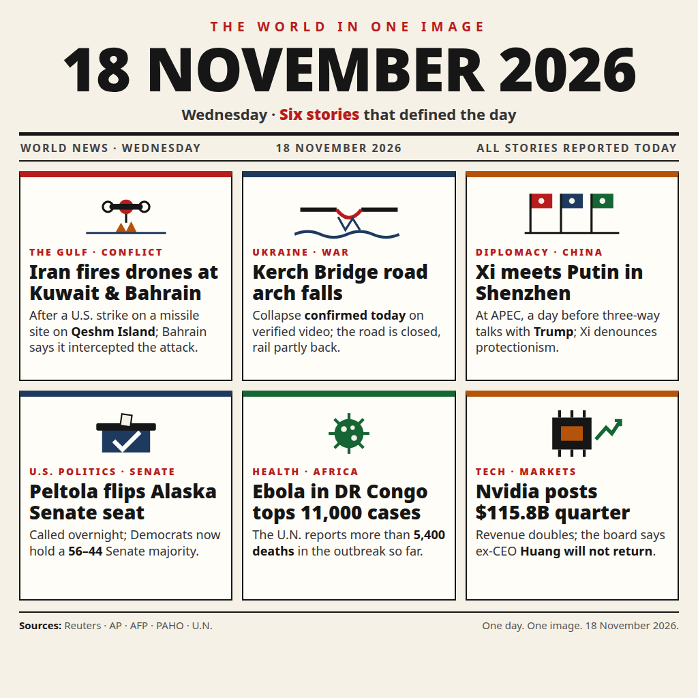

# 18 November 2026 — The Day in One Image

[](https://make.fun/bounty/news-image-20261118)
[](https://make.fun/bounty/news-image-20261118)
[](https://make.fun/bounty/news-image-20261118)

Entry for [news-image-20261118](https://make.fun/bounty/news-image-20261118):
sum up the world's news of Wednesday 18 November 2026 in one image.



## The day, in six stories

All six were reported on 18 November 2026 (events that happened, or were
first reported, on that day):

1. **The Gulf** — Iran fires drones at Kuwait & Bahrain, after a U.S. strike
   on a missile site on Qeshm Island; Bahrain says it intercepted the attack.
2. **Ukraine** — the Kerch Bridge road arch falls; the collapse is confirmed
   on verified video, the road is closed, rail partly back.
3. **Diplomacy** — Xi meets Putin in Shenzhen at APEC, a day before three-way
   talks with Trump; Xi denounces protectionism.
4. **U.S. politics** — Peltola flips the Alaska Senate seat, called
   overnight; Democrats now hold a 56–44 Senate majority.
5. **Health** — Ebola in DR Congo tops 11,000 cases; the U.N. reports more
   than 5,400 deaths in the outbreak.
6. **Tech** — Nvidia posts a $115.8B quarter; revenue doubles and the board
   says ex-CEO Huang will not return.

Sources: Reuters · AP · AFP · PAHO · U.N.

## Run

```sh
mkdir -p out && MAKEFUN_OUTPUT_DIR=out node main.ts
```

`main.ts` (Node 22, standard library only, no network) copies `entry.png`
to `$MAKEFUN_OUTPUT_DIR/entry.png`. Both runs write the same bytes.

## How the image was made

`render.html` is a newspaper front page (masthead, dateline, six story
cards with flat SVG icons, sources footer), rendered to the 1024×1024
`entry.png` with the local headless Chrome:

```sh
node render.mjs
```

No external image is used: every pictogram is drawn in the page's own SVG.
